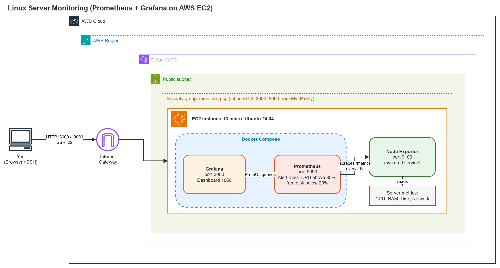
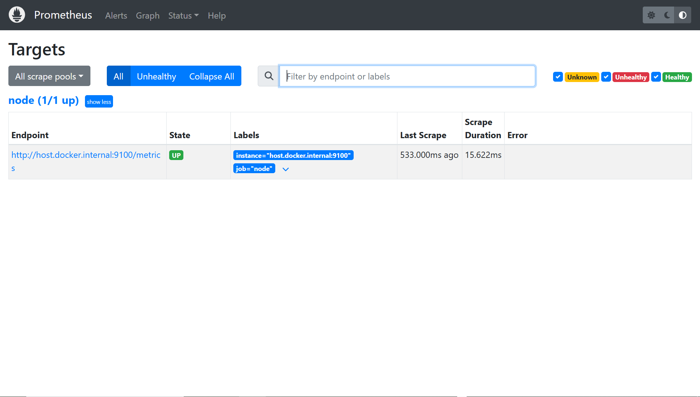
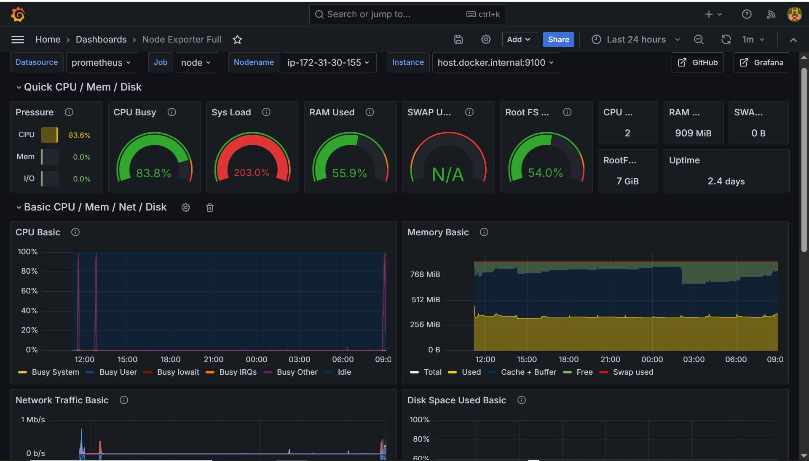
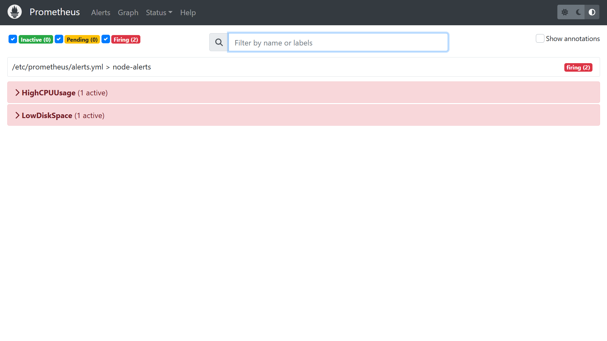

# Linux Server Monitoring with Prometheus & Grafana

Monitors the health of a Linux server on AWS EC2 (CPU, memory, disk, network) with live dashboards and alerts for high CPU and low disk space.

## Architecture



## Tools

| Tool | Role |
|------|------|
| **AWS EC2** (Ubuntu 24.04, t3.micro) | The server being monitored |
| **Node Exporter** | Measures server metrics and publishes them on port 9100 |
| **Prometheus** | Scrapes and stores metrics, evaluates alert rules |
| **Grafana** | Visualizes metrics (community dashboard ID 1860, "Node Exporter Full") |
| **Docker Compose** | Runs Prometheus and Grafana |

## Setup

1. **Launch EC2** with a dedicated security group: SSH (22), Grafana (3000) and Prometheus (9090), all restricted to *My IP*. Port 9100 is not exposed.
2. **Install Node Exporter** as a systemd service (`node_exporter.service`) so it starts on boot.
3. **Run Prometheus and Grafana** with `docker compose up -d`.
4. **Add Prometheus as a Grafana data source** (`http://prometheus:9090`) and import dashboard `1860`.
5. **Alert rules** (`alerts.yml`), each evaluated over 2 minutes:
   - `HighCPUUsage`: CPU busy above 80%
   - `LowDiskSpace`: free disk space below 20%

## Results

| Targets UP | Dashboard | Alert firing |
|:--:|:--:|:--:|
|  |  |  |

## Problems & Solutions

| Problem | Cause | Fix |
|---------|-------|-----|
| SSH to EC2 timed out | My ISP changed my public IP, so the security group's *My IP* rule was outdated | Diagnosed with `ssh -vvv`, `nc -vz -w 5 <ip> 22` and `curl https://checkip.amazonaws.com`, then updated the rule to my current IP |
| CPU alert stayed *Inactive* during stress test | A single run only reached ~54% CPU on the burstable t3.micro, below the 80% threshold | Ran `stress --cpu 4 --timeout 300` repeatedly until CPU passed 80% (reached 83.8%); lowered thresholds temporarily to validate the alert pipeline, then restored them |
| Alerts page showed no change | Prometheus' alerts page does not auto-refresh | Refreshed manually to watch *Pending* then *Firing* |

**Key lessons:** an SSH *timeout* means a network problem, while `Permission denied (publickey)` means a key problem. Public IPs can change, so IP-restricted firewall rules need rechecking.

## Run it yourself

```bash
# On the server: install Node Exporter (see node_exporter.service), then:
docker compose up -d
# Prometheus: http://<server-ip>:9090   Grafana: http://<server-ip>:3000
```

## Cleanup

`docker compose down`, then stop or terminate the EC2 instance to avoid charges.
